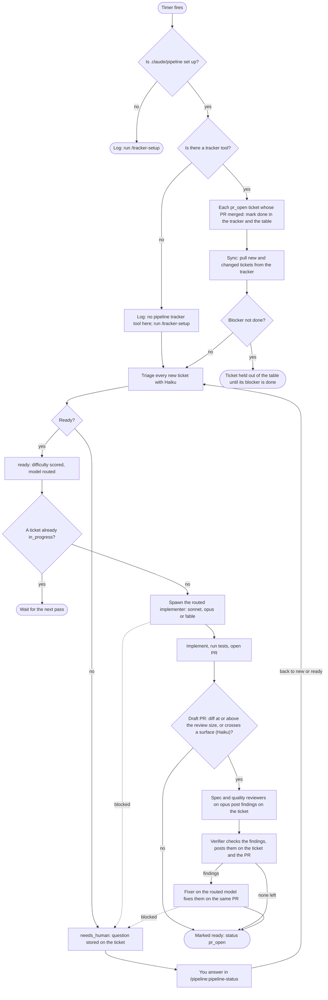

# pipeline

A Claude Code plugin that works your ticket board in the background. A loop syncs tickets from your tracker,
Haiku triages each one, and the model it routes to implements it in its own git worktree and opens its own PR.
You keep the main thread for spec, plan and review, and are only pulled in when a ticket needs you.

## Run it

The pipeline is two plugins from this repo: `pipeline` (the repo root) runs the loop, and `pipeline-agents` (the
`pipeline-agents/` folder) holds the hooks its agents need (see `docs/adr/0001`). Load both for one session:

```sh
claude --plugin-dir /path/to/pipeline-plugin --plugin-dir /path/to/pipeline-plugin/pipeline-agents
```

`pipeline` declares `pipeline-agents` under `dependencies`. With only `pipeline` loaded, the loop runs but no
agent's result is ever recorded.

A hot reload swaps in changed code (`hooks/`, `src/`) but not the agent definitions: a running session keeps the
`agents/*.md` prompts it loaded at start, so a change to one needs a session restart. When a reload finds an agent
prompt changed since session start, the loop logs `agent prompts changed (<files>); restart the session to apply
them`.

The plugin needs `python3` on the `PATH`: the implementer and fixer write every PR with the
`pipeline:writing-pull-requests` skill, and its `scripts/pr.py` runs under `python3`.

Then, in your project:

| command | what it does |
|---|---|
| `/pipeline:tracker-setup` | Connects the pipeline to your tracker and PR host: writes the project mod `.claude/skills/pipeline-tracker/`, whose one `tracker` tool the loop, the agents and the skills use, with its README and contract tests. Run once per project, and again to switch tracker or to port a `tracker.md`. |
| `/pipeline:pipeline-status` | Shows where every ticket stands and lets you answer the ones in `needs_human`. |
| `/pipeline:learn` | Works through the review of the pipeline's PRs with you (human comments, and the verifier's findings with the fixer's outcome) and changes the file that would have prevented each problem. |

Once `/pipeline:tracker-setup` has run, the loop starts with the session: the first pass runs 10 seconds after start,
then one pass every 5 minutes. Pipeline state lives in `.claude/pipeline/pipeline.db`. The tracker and the PR host
are reached only through the `tracker` tool (`mcp__pipeline-tracker__tracker`), so an MCP-only Jira, Linear or
GitHub works like one with a CLI; the ops are listed in `SPEC.md` under "The tracker tool".

## One loop pass



The loop never waits on a human: anything it cannot decide is set to `needs_human` with its question, and the
pass moves on. An `in_progress` ticket whose verifier or fixer is no longer running has it started again once; one
whose implementer is gone, or whose verifier or fixer is gone a second time, goes to `needs_human`, and so does one
whose owning session has stopped: several sessions may load the pipeline on one
project, and each moves on only the tickets it claimed. Agent review is one round only; the `Draft: ` prefix comes off the PR title when it is done.
A ticket blocked by another in the tracker is held until its blocker is done; marking merged PRs done before
sync releases it in the same pass, so it is built on its blocker's merged code. `/pipeline:pipeline-status`
lists held tickets and what holds each.

## Tests

```sh
npm install           # once per checkout, worktrees included
npm test              # typecheck, then unit tests under node
npm run typecheck     # tsc over both plugins
npm run test:plugin   # claude plugin test pipeline-agents
npm run types:vendor  # refresh types/vendor from .claude-plugin/types/
```

Node strips types without checking them, so `npm test` runs `tsc` first. The engine writes its types to
`.claude-plugin/types/` each time it loads the plugin, which is gitignored and absent in a fresh worktree, so the
tsconfig files read a committed snapshot in `types/vendor/` instead. After a Claude Code update, run
`npm run types:vendor` in a checkout the engine has loaded. The snapshot leaves out `claude-code-mcp`: it lists the
MCP servers of the session that wrote it, not the engine.

The plugin tests load `pipeline-agents` with a stand-in for the loop named `pipeline`.
`pipeline-agents/test/report-result.test.ts` checks that an agent `pipeline` spawned from its timer gets its
`report_result` call answered, and would not if `pipeline` owned the tool. `pipeline-agents/test/tracker-tool.test.ts`
checks that a stand-in `pipeline-tracker` mod answers both the loop's own `tracker` call and that of an agent the
loop spawned. The root plugin has no plugin tests: `claude plugin test pipeline-agents`
(`npm run test:plugin`) is the only plugin-test invocation, since a root run loads the real `pipeline` and never
loads the nested `pipeline-agents` folder.
